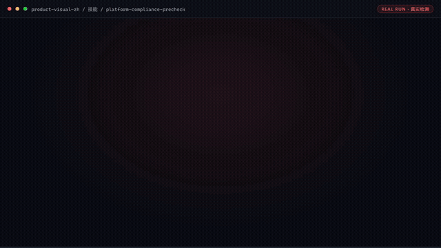

# 商品视觉师

> **一人店的"到岗美工"，只出能直接上架的合规商品图**



*▲ 真实执行录播（自动循环播放）· [▶ 观看完整版合集视频](docs/demo.mp4)*

[](#资产形态)
[](#资产形态)
[](#资产形态)
[](#资产形态)
[](LICENSE)

## 30 秒上手

| 你在用什么 | 怎么装 |
|---|---|
| **WorkBuddy** | 资料库搜索「商品视觉师」→ 一键添加为数字员工 |
| **Coze / Dify** | 复制各技能 `SKILL.md` 正文到智能体 system prompt（纯提示词，无 API Key） |
| **手动 / CLI** | `git clone https://github.com/bangwozuo/product-visual-zh` → 各技能带 `scripts/*.py` 可直接跑 `--demo` |

## 和直接问 AI 有什么区别

| | 直接问 ChatGPT/豆包 | 本资产包 |
|---|---|---|
| 合规检查 | 靠模型自由发挥，漏检不负责 | 24 条规则表逐条扫描，输出可审计的 Excel 清单 |
| 图片质量 | 无量化标准 | 保真六维比对 + GB/T 2828.1 抽样判定 |
| 上架规格 | 每个平台重新问 | 四平台规格一次适配 |
| 结果责任 | 对话结束即忘 | 每次产出落盘（JSON/Excel/图片），可追溯 |

## 不做什么（Non-goals）

不做品牌 VI 设计 · 不做仿冒/虚假功效图 · 不接平台私有 API · 不做通用美工（只做电商商品图这一件事）。

---

## 数字员工总览

| 项 | 内容 |
|------|------|
| 身份 | **商品视觉师**——一人店的"到岗美工"，只出能直接上架的合规商品图 |
| 边界 | 做：商品图生成、质检、合规预审、多平台适配；不做：品牌 VI、仿冒与虚假功效图 |
| 硬卡点 | 每张 AI 生成图上架前过 `product-fidelity-check`（保真）+ `platform-compliance-precheck`（合规）双卡点 |
| KPI | 一次过审率 ≥90%；单张交付 ≤5 分钟；返工率 ≤10% |
| 目标用户 | 月上新 5-50 款的四平台一人店/夫妻店（电商小卖家） |

---

## 它是谁

面向 **电商小卖家** 的数字员工资产包。

| 项目 | 内容 |
|------|------|
| 目标用户 | 月上新 5-50 款的四平台一人店/夫妻店 |
| 交付物 | 一次过审率 ≥90%；单张交付 ≤5 分钟；返工率 ≤10% |
| 技能数 | 6 |
| 工作流数 | 5 |
| 旧名存档 | `视觉设计师·小图` |

---

## 资产形态

**提示词资产 + 离线质检脚本** —— 这是理解本仓库的关键：

| 特性 | 说明 |
|------|------|
| ✅ 无需 API Key | 一个 Key 都不需要 |
| ✅ 无需部署 | 没有服务端；质检脚本（保真/白底/排版/工作流）可离线复跑 |
| ✅ 平台无关 | 提示词粘贴到任何 AI 工具即可使用 |
| ✅ 真实可验证 | 量化指标全部来自脚本实测，README 截图为真实执行产物 |
| ✅ 用户自备算力 | 模型来自你自己的订阅 |

---

## 快速开始

```text
1. 打开 skills/white-bg-image-generate/prompt.txt
2. 全文复制
3. 粘贴到你常用的 AI 工具（Coze / WorkBuddy / Dify / Claude / ChatGPT）
4. 按 SKILL.md 的输入规格提供数据
```

就这四步。完整指引见 [使用手册](docs/04-usage.md)。

---

## 仓库结构

```text
product-visual-zh/
├── README.md / employee.md / package.yaml     # 入口与 12 字段定义卡
├── docs/01~07                                 # 员工级文档（架构/流程/场景/手册/示例/录像/测试）
├── skills/                                    # 6 个原子技能
│   └── <skill>/
│       ├── README.md  SKILL.md  prompt.txt  schema.json  examples/
│       └── docs/                              # 该技能自己的 10 项文档 + 配图
├── workflows/                                 # 5 条工作流（复合技能）
│   └── <workflow>/
│       ├── README.md  SKILL.md  prompt.txt  schema.json  examples/
│       └── docs/                              # 该工作流自己的 10 项文档 + 配图
├── knowledge/                                 # RAG wiki 知识库
│   ├── README.md  RAG-接入指南.md  template.md
│   └── wiki/(index.md, _template.md, entries/)
├── connectors/                                # 连接器说明 + 合规红线
├── quality/                                   # 效果基线与追踪日志
└── tests/                                     # 资产校验测试（离线，无需密钥）
```

### 每个技能 / 工作流自带的 docs

| 文档 | 内容 |
|------|------|
| `README.md` | 资产速览与快速开始 |
| `docs/01-usage-manual.md` | 安装使用手册 |
| `docs/02-architecture.md` | 业务架构图 |
| `docs/03-flow.md` | 流程图（Mermaid + 配图） |
| `docs/04-examples.md` | 使用示例 |
| `docs/05-media.md` | 截图和录屏（清单 + 分镜脚本） |
| `docs/06-scenarios.md` | 使用场景（适用 / 不适用） |
| `docs/07-audience.md` | 用户群体 |
| `docs/08-value.md` | 解决问题与价值 |
| `docs/09-test-report.md` | 测试报告 |
| `docs/assets/overview.svg` | 自动生成的流程示意图 |

---

## 交付物导航

| 文档 | 内容 |
|------|------|
| [业务架构](docs/01-architecture.md) | 四层架构 + 数据流 + 能力边界 |
| [工作流流程](docs/02-workflow.md) | 5 条工作流的 DAG 可视化 |
| [使用场景](docs/03-scenarios.md) | 3 个真实场景（含前后对比） |
| [使用手册](docs/04-usage.md) | 各平台导入指引 + 常见问题 |
| [示例库](docs/05-examples.md) | 6 组输入输出示例 |
| [录像脚本](docs/06-recording-script.md) | 7 镜头分镜 + 旁白稿 |
| [校验报告](docs/07-test-report.md) | 资产质量校验结果 |

---

## 技能清单（6 个）

| # | 技能 | 能力族 | 复杂度 | 说明文档 |
|---|------|--------|--------|----------|
| 1 | 白底图生成 | 图像生成与处理 | `S` | [README](skills/white-bg-image-generate/README.md) |
| 2 | 场景图合成 | 图像生成与处理 | `M` | [README](skills/scene-image-compose/README.md) |
| 3 | 产品保真校验 | 一致性与保真校验 | `M` | [README](skills/product-fidelity-check/README.md) |
| 4 | 平台合规预审 | 合规校验 | `S` | [README](skills/platform-compliance-precheck/README.md) |
| 5 | 文案排版 | 图像生成与处理 | `S` | [README](skills/copy-layout/README.md) |
| 6 | AI 模特换装 | 图像生成与处理 | `L` | [README](skills/ai-model-swap/README.md) |

## 工作流清单（5 条）

| # | 工作流 | 阶段 | 复杂度 | 触发 | 说明文档 |
|---|--------|------|--------|------|----------|
| 1 | 商品图批量生成与质检 | `P0` | `M` | 人工 | [README](workflows/product-image-batch-qc-flow/README.md) |
| 2 | 主图 A/B 版本生成 | `P0` | `S` | 人工 | [README](workflows/hero-image-ab-flow/README.md) |
| 3 | 平台合规预审 | `P0` | `S` | 事件（出图完成） | [README](workflows/platform-compliance-flow/README.md) |
| 4 | 多平台规格一键适配 | `P1` | `M` | 事件（新品上架） | [README](workflows/multi-platform-spec-flow/README.md) |
| 5 | 详情页排版生成 | `P1` | `M` | 人工 | [README](workflows/detail-page-layout-flow/README.md) |

---

## 知识库与连接器

| 目录 | 说明 |
|------|------|
| [`knowledge/`](knowledge/README.md) | RAG wiki 知识库：填入业务信息可显著提升输出质量 |
| [`connectors/`](connectors/README.md) | 连接器说明：数据从哪来、怎么合规地来 |

---

## 资产校验

```bash
pip install -r requirements.txt
pytest tests/ -v
```

校验技能完整性、提示词结构、契约一致性、工作流 DAG、技能级与工作流级 docs 完整性、知识库 wiki 与连接器结构。
**不需要任何 API Key。**

---

## 合规声明

- ✅ 所有输出为 **AI 辅助生成**，交付前须人工审核
- ✅ 提示词内置**违禁词禁止清单**，符合《广告法》要求
- ✅ 遵循《人工智能生成合成内容标识办法》
- ✅ 连接器只走**官方 API** 或**用户导出数据**
- ✅ 所有对外发布动作**保留人工确认环节**

---

## 许可

[Apache-2.0](LICENSE) — 可自由使用、修改、商用

---

*由 bangwozuo 业务库自动生成 · 2026-09-29*
